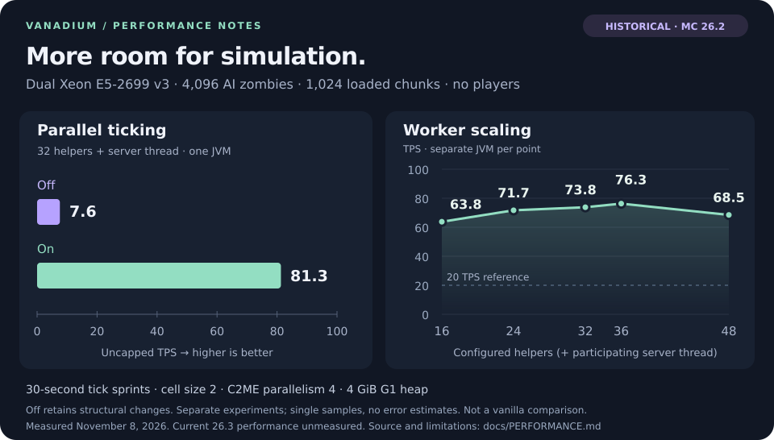

  

  <strong>Put more of your CPU to work.</strong> 
  A Fabric mod that spreads Minecraft server simulation across cores.

  
  
  

Vanadium parallelizes entity, block-entity, scheduled and chunk ticking, natural spawning,
and entity tracking. A shared worker pool runs independent chunk cells concurrently,
keeping neighboring cells apart and completing each stage before the next begins.
It also optimizes chunk lookups, nearby-player indexing and packet preparation.

### Performance

**Historical 26.2 measurements, not a 26.3 performance claim.** Dual Xeon E5-2699 v3 VM,
4,096 AI zombies, 1,024 loaded chunks, no players. Uncapped throughput; higher is better.
“Off” keeps Vanadium's structural changes installed. The comparison and scaling sweep
are separate experiments. [Data, method and limits →](docs/PERFORMANCE.md)

### Getting started

Use **Minecraft 26.3**, **Fabric Loader 0.20.1+** and **Java 25+**. Build with `./gradlew build`
([setup](docs/DEVELOPMENT.md)), then place the release jar from `build/libs/` in `mods/` alongside:

- [Fabric API](https://modrinth.com/mod/fabric-api) and [Fabric Language Kotlin](https://modrinth.com/mod/fabric-language-kotlin)
- [Cloth Config](https://modrinth.com/mod/cloth-config) and [C2ME](https://modrinth.com/mod/c2me-fabric)

**C2ME is required:** it handles parallel generation/loading while Vanadium handles ticking.
**Lithium and VMP are incompatible.** Test your world and modpack before deployment.

Configure `config/vanadium.toml`; use `/vanadium reload` to apply changes and
`/vanadium status` to inspect them. Worker-count changes require a restart.

### Learn more

[Configuration & commands](docs/CONFIGURATION.md) · [Development](docs/DEVELOPMENT.md) ·
[Architecture](docs/ARCHITECTURE.md) · [Profiling](docs/PROFILING.md) ·
[Report an issue](https://github.com/synsejse/Vanadium/issues)

Originally derived from [JMT-MCMT](https://github.com/jediminer543/JMT-MCMT) through
[MCMTFabric](https://github.com/himekifee/MCMTFabric); Vanadium now develops its own architecture.
Licensed under [GPLv3](LICENSE).
