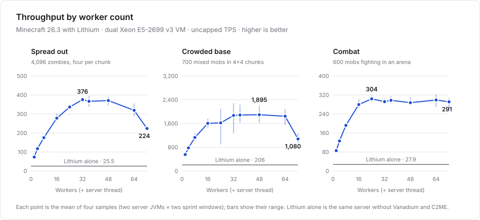

  

<h1 align="center">Vanadium</h1>

  Parallel server ticking for Minecraft. Put more of your CPU to work.

  
  
  

Vanadium parallelizes entity, block-entity, scheduled and chunk ticking, natural spawning,
and entity tracking. Entities tick in one wave across every worker wherever they are, in a crowded base
as well as across the map: each owns itself while it ticks, and what entities do to each other is locked
per interaction. The other stages run separate parts of the world concurrently: regions adapt to where
the work is, nearby work never overlaps, and each stage completes before the next.
It also optimizes chunk lookups, nearby-player indexing and packet preparation.

### Performance

<picture>
  <source media="(prefers-color-scheme: dark)" srcset="docs/assets/performance-dark.svg">
  
</picture>

The chart: Minecraft 26.3 on the dual Xeon test VM (36 cores, 72 threads), uncapped tick rate, no
players, no extra JVM flags, measured 2026-11-14 at `e29ec28`. With the default 36 workers Vanadium ran
these worlds 9–14× faster than the same server with Lithium alone. Throughput levels off between 24
and 48 workers, and the default (one worker per physical core, leaving a logical processor for the
server thread) measured within 2.5% of each world's best count; one worker per logical processor ran
up to 43% below it. In separate runs of the same build at 36 workers, the
[recommended JVM flags](docs/PERFORMANCE.md#recommended-jvm-flags) added another 12–65% on this
two-socket machine. Try a few values of `workers` on your own machine.
[Data, method and limits →](docs/PERFORMANCE.md#worker-count)

### Getting started

Use **Minecraft 26.3**, **Fabric Loader 0.20.1+** and **Java 25+**. Build with `./gradlew build`
([setup](docs/DEVELOPMENT.md)), then place the release jar from `build/libs/` in `mods/` alongside:

- [Fabric API](https://modrinth.com/mod/fabric-api) and [Fabric Language Kotlin](https://modrinth.com/mod/fabric-language-kotlin)
- [Cloth Config](https://modrinth.com/mod/cloth-config), [C2ME](https://modrinth.com/mod/c2me-fabric)
  and [Lithium](https://modrinth.com/mod/lithium)

Each build is tested only with the versions it pins (C2ME 0.4.2-alpha.0.116, Lithium 0.26.3); later
versions satisfy the manifest but are untested.

**C2ME and Lithium are required:** C2ME handles parallel generation/loading, Lithium makes each tick
cheaper, and Vanadium spreads ticks across cores. Vanadium turns off the few Lithium options whose job it
does itself in a thread-safe way, and makes the Lithium state that parallel ticks share in the pinned
version thread-safe ([details](docs/ARCHITECTURE.md#c2me-and-lithium)).

**Other mods that change how the server ticks are declared incompatible** (Async, DimThread, MCMT,
Moonrise, ServerCore, VMP): Vanadium owns entity ticking, the chunk lookup path and the tick loop's
stages, and a second mod rewriting them cannot be made safe from here. Content mods are untested:
their entities and block entities tick in parallel like vanilla's, and their writes to other
entities through vanilla's methods are protected, but a mod's own shared state and pairwise logic are not
([flat entity wave](docs/ARCHITECTURE.md#flat-entity-wave)). `serialEntityTypes` and
`serialBlockEntityTypes` move a mod's tickers to the server thread; they do not isolate its shared
state, scheduled ticks or callbacks ([serial type rules](docs/CONFIGURATION.md#serial-type-rules)).
Test your world and modpack before deployment.

Configure `config/vanadium.toml`; use `/vanadium reload` to apply changes and
`/vanadium status` to inspect them. Worker-count changes require a restart.

### Learn more

[Configuration & commands](docs/CONFIGURATION.md) · [Development](docs/DEVELOPMENT.md) ·
[Architecture](docs/ARCHITECTURE.md) · [Profiling](docs/PROFILING.md) ·
[Report an issue](https://github.com/synsejse/Vanadium/issues)

Originally derived from [JMT-MCMT](https://github.com/jediminer543/JMT-MCMT) through
[MCMTFabric](https://github.com/himekifee/MCMTFabric); Vanadium now develops its own architecture.
Licensed under [GPLv3](LICENSE).
